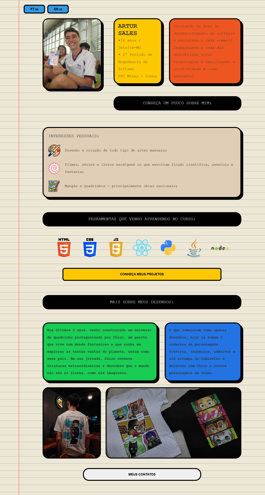
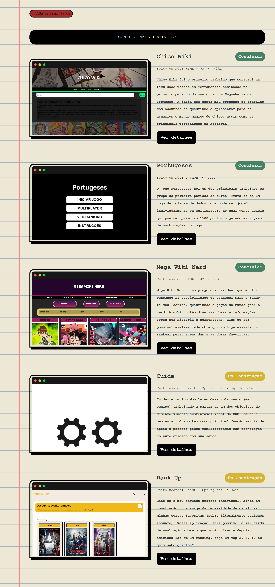
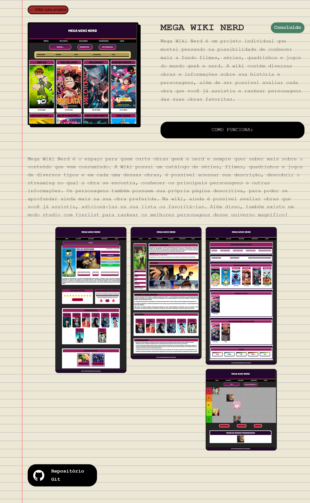
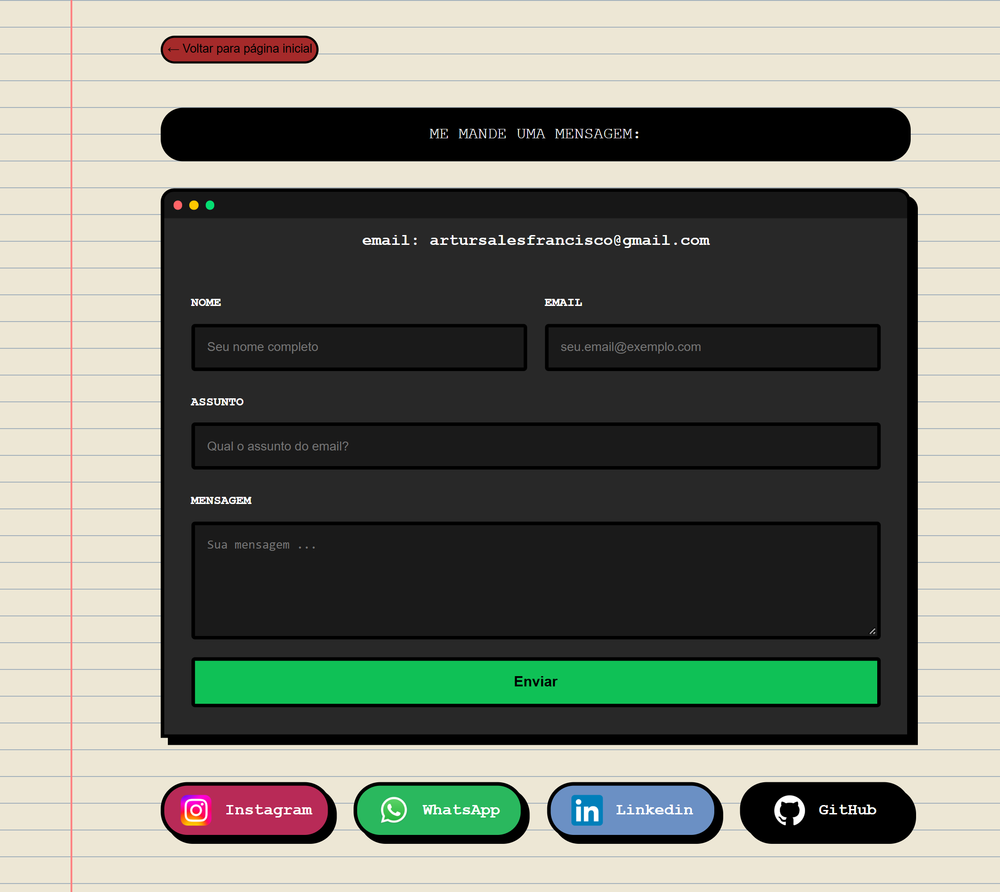

# Portfolio - Artur Sales Francisco

Esse é meu portifólio profissional que reune meus projetos durante minha, até então, trajetória no curso de engenharia de software. A interface do projeto simula páginas de um caderno que representam assertivamente gostos e personalidade do autor.


## Status do Projeto


## Índice

- [Sobre o Projeto](#sobre-o-projeto)
- [Funcionalidades](#funcionalidades)
- [Tecnologias](#tecnologias)
- [Arquitetura](#arquitetura)
- [Instalação e Execução](#instalação-e-execução)
- [Scripts Disponíveis](#scripts-disponíveis)
- [Estrutura de Pastas](#estrutura-de-pastas)
- [Demonstração](#demonstração)
- [Projetos em Destaque](#projetos-em-destaque)
- [Contato](#contato)
- [Autor](#autor)
- [Contribuição](#contribuição)
- [Licença](#licença)

## Sobre o Projeto

O portifólio serve como uma apresentação profissional de projetos realizados pelo autor durante os períodos já cursados do curso de engenharia de software.

Atualmente esse portifólio apresenta:

1. Apresentação pessoal e representações visuais;
2. Interesses pessoais do autor;
3. Projetos desenvolvidos ou em andamento;
4. Links para contato e redes sociais;
5. Formulário de contato (email);
6. Páginas individuais com detalhes de cada projeto.

### Link para o portifólio
[Portifólio](https://artur-sales-portifolio.onrender.com/)

## Funcionalidades
- **Navegação Dinâmica:** Transição entre as páginas utilizando o React Router.
- **Multilíngue (i18n):** Suporte completo para Português (PT) e Inglês (EN) integrado com a biblioteca `react-i18next`.
- **Página de Detalhes Dinâmica:** Rota dinâmica baseada no ID do projeto para exibir informações completas, descrição, funcionalidades e galeria de imagens individual.
- **Formulário de Contato Direto:** Sistema integrado com o **EmailJS** para envio de mensagens direto para o e-mail pessoal a partir da página de contato.
- **Design Responsivo & Neobrutalista:** Layout inspirado em folhas de caderno pautadas, desenvolvido com CSS puro, estilização moderna com sombras duras e adaptado para celulares e tablets.

## Tecnologias
### Front-end
- **React** (v18+)
- **Vite**
- **React Router Dom** (v6)
- **i18next / react-i18next**
- **EmailJS** (`@emailjs/browser`)
- **CSS3** (Variáveis, Flexbox, Gradients e Media Queries)

### Desenvolvimento
- **Node.js** e **npm**
- **Git** e **GitHub**
- **Render**

## Arquitetura
O projeto segue uma arquitetura baseada em componentes reutilizáveis e separação de responsabilidades no React:
- `src/components/`: Componentes reutilizáveis (Cards, Botões de Voltar, Botões de Contato).
- `src/pages/`: Telas principais da aplicação (`Home`, `Projetos`, `DetalhesProjeto`, `Contato`).
- `src/data/`: Arquivos estruturados contendo os dados dos projetos separados por idioma (`projetosPt.js`, `projetosEn.js`).
- `src/i18n/`: Configurações de tradução e arquivos JSON de interface.
- `public/assets`: Imagens utilizadas no projeto.

## Instalação e Execução

### Pré-requisitos
Certifique-se de ter o **Node.js** e o **npm** instalados na sua máquina.

### Clonando o repositório
```bash
git clone [https://github.com/ArturSalesFrancisco/portifolio](https://github.com/ArturSalesFrancisco/portifolio)
cd portifolio
```

### Instalando as dependências
```bash
cd portifolio-artur
npm install
```

### Executando em desenvolvimento
```bash
npm run dev
```

O projeto estará rodando localmente na porta 5173

### Visualizando o build localmente
Para gerar os arquivos otimizados de produção e testá-los:
```bash
npm run build
npm run preview
```

## Scripts Disponíveis
**npm run dev**: Inicia o servidor de desenvolvimento com o Vite.

**npm run build**: Compila o código para produção na pasta dist.

**npm run preview**: Visualiza o build de produção localmente.

## Estrutura de Pastas
portifolio-artur/
├── public/
│   └── assets/         # Imagens, ícones e mídias
├── src/
│   ├── components/     # Componentes visuais reutilizáveis
│   ├── data/           # Arrays de dados dos projetos (PT e EN)
│   ├── i18n/           # Arquivos de tradução e configuração
│   ├── pages/          # Páginas principais (Home, Projetos, Detalhes, Contato)
│   ├── App.jsx         # Configuração das rotas principais
│   ├── main.jsx        # Ponto de entrada do React
│   └── index.css       # Estilos globais e fundo de caderno
├── package.json
└── vite.config.js

## Demonstração
| Sobre Mim | Projetos | Detalhes | Contato |
|---|---|---|---|
|  |  |  |  |
|---|---|---|---|

## Projetos em Destaque

### Chico Wiki
Wiki interativa para apresentar o universo e os personagens de um quadrinho autoral.

### Portugeses
Jogo de rolagem de dados desenvolvido em Python (Pygame).

### Mega Wiki Nerd
Catálogo interativo de filmes, séries, jogos e quadrinhos com sistema de avaliações e tierlists.

### Cuida+
Aplicativo mobile voltado para a saúde e bem-estar (em desenvolvimento).

### Rank-Up
Aplicação web para catalogar e criar rankings personalizados de itens favoritos.

## Contato
E-mail: artursalesfrancisco@gmail.com

[GitHub:](https://github.com/ArturSalesFrancisco)

[LinkedIn:](https://www.linkedin.com/in/artur-sales-10b7aa450/)

[Instagram:](https://www.linkedin.com/in/artur-sales-10b7aa450/)

## Autor
Desenvolvido por Artur Sales Francisco — Estudante de Engenharia de Software na PUC Minas (Coreu).

## Licença

Nenhuma licença foi definida explicitamente neste repositório. Entre em contato com o autor antes de reutilizar o código ou os recursos de forma pública.